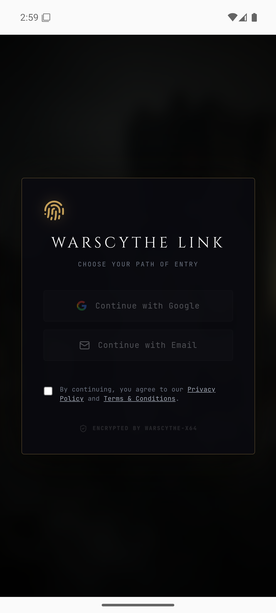

# Warscythe

### An execution RPG. Make showing up count.

Warscythe turns everyday tasks, habits and workouts into persistent progress in a fantasy world. It is built for students, young professionals and small teams who want their effort to feel meaningful before the exam result, finished project or fitness milestone arrives.

**The idea:** completing work should leave more than a disappearing checkmark. Your actions build a character, a history and a world worth returning to.

[Reviewer walkthrough](docs/reviewer-guide.md) · [Local setup](docs/getting-started.md) · [Architecture](docs/architecture.md) · [Evidence and limitations](docs/verification.md)

## The everyday loop

**Commit → execute → record progress → return.**

| In your day | In Warscythe |
| --- | --- |
| Finish a study session or project task | **Operations**: tasks, subtasks and focused execution |
| Show up repeatedly | **Rituals**: recurring habits and completion history |
| Look back at the work you put in | **Ledger**: records, artifacts and accumulated progress |
| Train consistently | **Fitness**: workout tracking with a fantasy setting |
| Work toward shared goals | **Legion**: social and team execution |
| Personalize your journey | **Forge and cosmetics**: scythes, themes and progression |

The intended benefit is consistency and visible effort. Improved retention, learning outcomes or fitness outcomes have **not** been established by a controlled evaluation.

## Current status

An early-stage React web application with a Capacitor Android wrapper. The repository contains application screens, local state and Supabase integration; that is not a claim that every flow has passed current end-to-end verification.

- **Implemented in source:** Operations, Rituals, Ledger, Fitness, Legion, progression and cosmetic/payment integration.
- **Requires configured services:** sign-in, cross-device persistence, social interactions, remote artwork and payment flows.
- **In development:** the local Fitness V2/Olympus prototype and responsive artwork migration. Local previews can differ from the committed or deployed app.
- **Not established:** production readiness, a reproducible clean-room backend bootstrap, current user metrics or independently measured performance.

## See the product

Start with the [three-minute reviewer walkthrough](docs/reviewer-guide.md): create an Operation, complete a Ritual, then inspect the resulting history. This is the clearest demonstration of the product idea; backend persistence needs a separate check.

An existing Android emulator capture is included below. It shows the actual entry screen, **not** a mockup or proof that authentication succeeds. Its original capture date and build are unknown.



## Run locally

Use Node.js **22.12 or newer** and npm. From the repository root:

```sh
npm ci
```

Copy `.env.example` to `.env.local`, configure your own development Supabase project, then:

```sh
npm run dev
```

Open the address printed by Vite. Full setup, service boundaries, Android requirements and troubleshooting are in [Getting started](docs/getting-started.md). A fresh-machine installation was not performed for this documentation update.

## Find your way around

| Looking for | Start here |
| --- | --- |
| What to try and what to observe | [Reviewer guide](docs/reviewer-guide.md) |
| Environment, commands and setup limitations | [Getting started](docs/getting-started.md) |
| Frontend, state, backend and assets | [Architecture](docs/architecture.md) |
| Verification scope, historical report and known gaps | [Evidence and verification](docs/verification.md) |
| Application screens | [src/pages](src/pages) |
| Database and server functions | [supabase](supabase) |
| License | [MIT license](LICENSE) |

Build → measure → verify → close → then expand.
