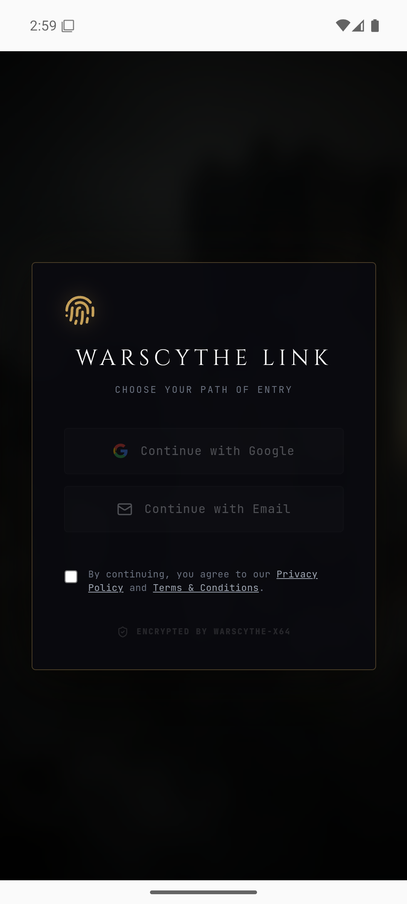

# Reviewer walkthrough

[Back to README](../README.md)

## Three minutes: effort becomes progress

Use a configured development instance and a disposable account. This is a proposed inspection route, not a record of a freshly passed test.

1. **Operations:** create a small task such as “Review one chapter.” Open it, inspect its subtasks or focus flow, then complete it. Observe the completion feedback and progress change.
2. **Rituals:** create a recurring action such as “Read for ten minutes.” Complete it and inspect the displayed completion history or streak. Check whether a second completion is permitted; do not assume duplicate protection.
3. **Ledger:** look for the resulting history and progression. The product proposition is that effort leaves a persistent record, even before the real-world outcome arrives.

For a deeper review, explore Fitness and Legion. Team workflows need another development account and working backend policies; one screen capture cannot establish collaboration correctness.

## What the included screenshot proves

This is an existing capture from `android-emulator-final.png`, copied without altering the interface. It depicts the Android entry screen. No account details are visible. Capture date and source build were not recorded. It does not demonstrate completed sign-in, retention, payments or current Android compatibility. Other artwork in the repository is not automatically a product screenshot.

## Stronger verification after the walkthrough

Reload and confirm the completed task remains completed. Then check a second session against the same development account to distinguish local storage from server persistence. Repeat on a narrow viewport and inspect menus, dialogs and long task titles. Record the commit, viewport, browser, account type and backend environment with the result.

The Test Realm uses synthetic state and is useful for screen inspection only. Keep its results separate from authenticated and multi-user tests.
